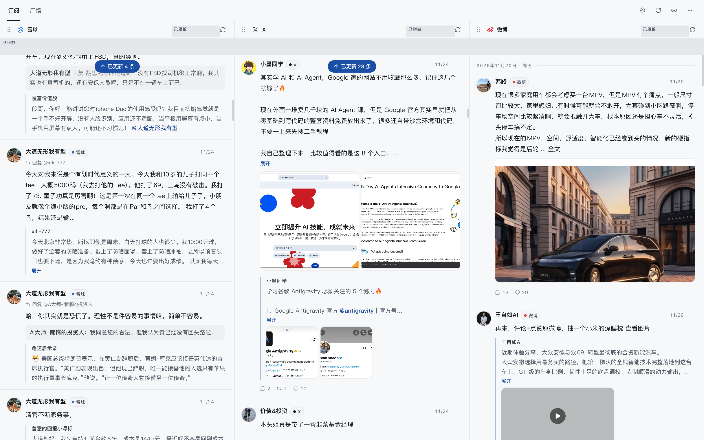
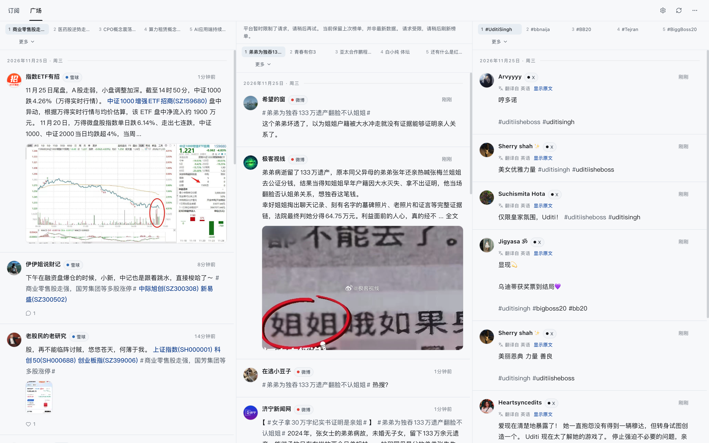
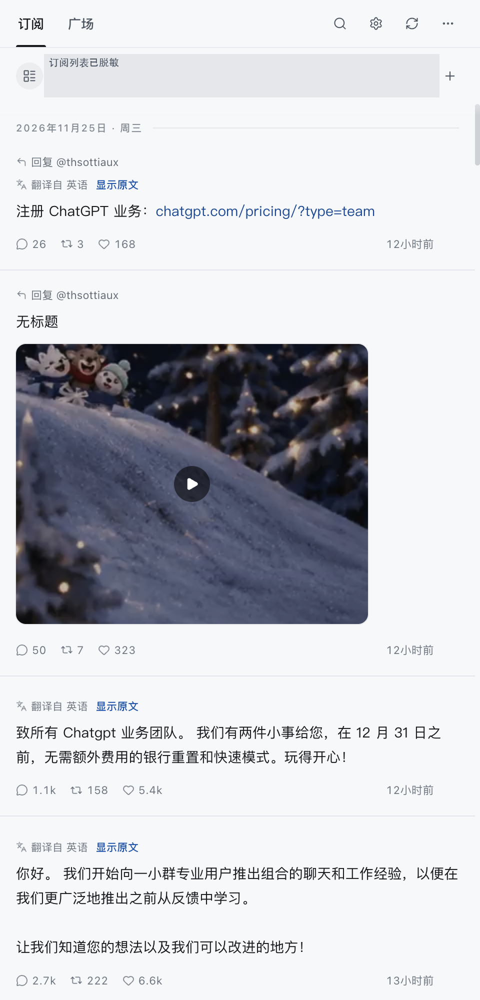

# Lesen · 莱森

把雪球、微博、X 上你关注的内容，收到同一个阅读界面里。Chrome 扩展，支持弹窗、独立阅读窗和窄宽侧栏（`sidepanel.html`，非浏览器原生侧栏停靠合影）。

**English:** [README.en.md](README.en.md)

| 你想… | 入口 |
| --- | --- |
| 日常使用（自动更新） | [Chrome 网上应用店](https://chromewebstore.google.com/detail/lesen-%C2%B7-%E8%8E%B1%E6%A3%AE-%C2%B7-%E5%A4%9A%E6%BA%90%E4%BF%A1%E6%81%AF%E8%81%9A%E5%90%88/dakdgplahfkbblfpafdjeipneioajgdf?hl=zh-CN) |
| 下载指定版本侧载包 | [Releases](https://github.com/wen-haoming/lesen/releases)（需维护者打版本 tag 后才有资产） |
| 从源码构建 | 见下方「开发者」 |
| 自建登录与同步 | [SELF_HOSTING.md](SELF_HOSTING.md) |

当前仓库版本：**1.8.9**（`package.json` 为唯一版本源）。GitHub 上为开源协作副本；**CNB 仍是维护者当前的正式商店送审通道**，本仓 Actions 默认不 live 上传、不替代 CNB，除非你方开启 `CWS_PIPELINE_ENABLED` 并完成切换。

## 截图（真实 UI，已脱敏）

来自已安装正式 1.8.9 的界面；`redacted` 文件保留脱敏标注。

| 多栏首页 | 公开广场 | 侧栏（窄宽 sidepanel） |
| --- | --- | --- |
|  |  |  |

完整列表与来源说明：[release-screenshots/README.md](release-screenshots/README.md)、[PROVENANCE.json](release-screenshots/public/v1.8.9/PROVENANCE.json)。

## 支持平台与局限

- **浏览器：** Chrome / Chromium **114+**（MV3）。Firefox 脚本仅供试验，未完整验收。  
- **信息源：** 雪球、微博、X；接口可能限流、要求登录或变更，不保证长期可用。  
- **新安装：** 不预置私人订阅；广场仅有少量公开示例。  
- **同步与登录：** 可选自托管 Supabase；未配置时仍可本地阅读。  
- **遥测：** 默认关闭，仅在你配置接收端后才可能发送。

请遵守各平台条款与当地法律；本扩展不提供绕过验证码或平台限制的能力。

## 开发者

需要 Node.js 20.19+、pnpm 10.11.1。

```sh
pnpm install --frozen-lockfile --ignore-scripts
pnpm compile && pnpm test && pnpm typecheck
pnpm build
node scripts/smoke-verify.mjs
```

`chrome://extensions` → 开发者模式 → **加载已解压的扩展程序** → 选择 `.output/chrome-mv3`。这是开发/验收构建，**不是**商店生产 OAuth 包。

打开发包与配图：

```sh
node scripts/package-artifacts.mjs    # sideload zip + tar + SHA256SUMS
pnpm release:images                   # 商店配图，输入仅 release-screenshots/
```

## 发布与下载（用户向）

- 用户公开下载：每个 Release **仅** 2 个附件 — `lesen-<版本>-sideload-chrome-mv3.zip` + 对应 `SHA256SUMS.txt`（只含该 zip）；截图与源码包在 Actions，不进 Release。  
- 自动发行：推送 `lesen-v*.*.*`（或兼容 `owlivo-v*.*.*`）tag 触发 [release.yml](.github/workflows/release.yml)。  
- 细节、校验步骤、与商店差异：[docs/RELEASE_DOWNLOADS.md](docs/RELEASE_DOWNLOADS.md)。

## 文档

| 文档 | 内容 |
| --- | --- |
| [CHANGELOG.md](CHANGELOG.md) | 版本更新说明（Release 正文来源） |
| [CONTRIBUTING.md](CONTRIBUTING.md) | 贡献与 PR |
| [SECURITY.md](SECURITY.md) | 安全报告 |
| [PRIVACY.md](PRIVACY.md) | 隐私说明 |
| [SELF_HOSTING.md](SELF_HOSTING.md) | 自托管 OAuth / 同步 |
| [docs/RELEASE_MIGRATION.md](docs/RELEASE_MIGRATION.md) | GitHub 与 CNB 发布管线说明（维护者） |
| [THIRD_PARTY_NOTICES.md](THIRD_PARTY_NOTICES.md) | 第三方许可 |

## 架构概要

- **WXT + React + TypeScript + Tailwind**：`src/` 为扩展与 UI；`src/platforms/` 适配各源 API。  
- **权限边界：** 仅请求扩展运行所需主机权限；可选 OAuth 与 Supabase 由 `WXT_PUBLIC_*` 注入，秘密不进仓库。  
- **数据：** 订阅与阅读状态默认在浏览器本地；启用同步时数据经你配置的 Supabase 项目，不由本仓库托管生产库。

## 许可

[MIT](LICENSE)。品牌名「Lesen / 莱森」与第三方平台名称不表示官方合作。